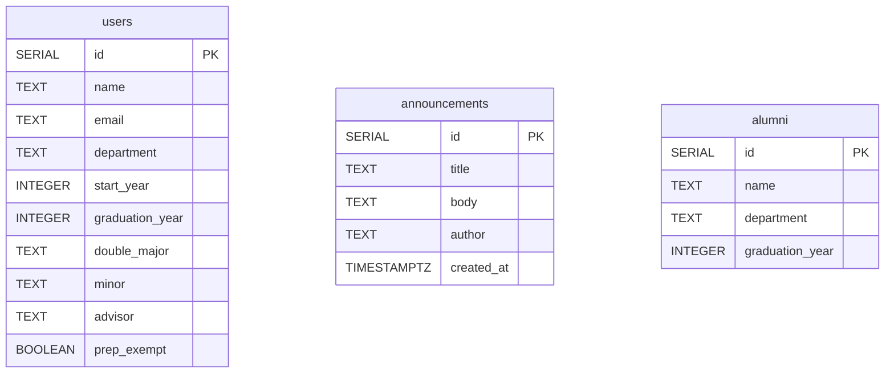

# Data Design Documentation

← Back to the [README](README.md)

This document describes the data the Alumni app stores **today**: where it lives, the tables,
their columns and rules, and how a row travels between PostgreSQL, Go and JSON. The longer-term
schema the platform is heading towards is in the README's [Data Model](README.md#data-model)
section.

## Contents

- [Where the data lives](#where-the-data-lives)
- [Entity–relationship diagram](#entityrelationship-diagram)
- [Tables](#tables)
  - [users](#users)
  - [announcements](#announcements)
  - [alumni](#alumni)
- [Migrations](#migrations)
- [Seed data](#seed-data)
- [Validation rules](#validation-rules)
- [From a request to a row](#from-a-request-to-a-row)
- [Design decisions](#design-decisions)
- [Known limits and next steps](#known-limits-and-next-steps)

## Where the data lives

```
 Postman / browser
        │  HTTP + JSON / HTML forms
        ▼
 ┌──────────────┐   SQL (pgx)    ┌──────────────┐
 │ app (Go)     │ ─────────────▶ │ db (Postgres)│
 │ port 8080    │                │ port 5432    │
 └──────────────┘                └──────┬───────┘
        ▲                               │ files
        │ /run/secrets/db_password      ▼
 secrets/db_password.txt         volume: db-data
```

| Piece | What it is | Defined in |
| --- | --- | --- |
| **Database** | PostgreSQL 17, the only place the app stores data | `docker-compose.yml` → `db` |
| **Volume `db-data`** | Postgres' data files. Survives `docker compose down`; only `down -v` deletes it | `docker-compose.yml` → `volumes` |
| **Schema** | Numbered migrations; the `migrate` service applies the new ones on every `up` | `migrations/`, `docker-compose.yml` → `migrate` |
| **Seed data** | Fixed samples + random records from the factories, added on demand | `internal/seed/`, `cmd/seed/`, `docker-compose.yml` → `seed` |
| **Password** | A Docker Compose secret, read from a file by both containers; never in git or in the image | `secrets/db_password.txt`, `docker-compose.yml` → `secrets` |
| **Connection** | One `pgxpool` connection pool, opened at startup | `internal/model/db.go` |

## Entity–relationship diagram



The three tables are **independent**: there are no foreign keys yet. `announcements.author` is
free text, not a link to `users`. See [Known limits](#known-limits-and-next-steps).

## Tables

Every table has an `id SERIAL PRIMARY KEY`: Postgres assigns the next number on `INSERT`, and
the app never takes an id from a request body. Text columns are `TEXT` (Postgres stores any
length the same way, so there is no reason to pick a `VARCHAR(n)` limit).

### users

One account on the network. Model: `internal/model/user.go` · API: `/api/users` · Pages: `/users`

| Column | Type | Null | Default | JSON field | Meaning |
| --- | --- | --- | --- | --- | --- |
| `id` | `SERIAL` | no | next number | `id` | primary key |
| `name` | `TEXT` | no | — | `name` | full name |
| `email` | `TEXT` | no | — | `email` | contact email |
| `department` | `TEXT` | no | — | `department` | bölüm |
| `start_year` | `INTEGER` | no | — | `startYear` | year the user started university |
| `graduation_year` | `INTEGER` | no | — | `graduationYear` | mezuniyet yılı |
| `double_major` | `TEXT` | no | `''` | `doubleMajor` | ÇAP; `''` means none |
| `minor` | `TEXT` | no | `''` | `minor` | yandal; `''` means none |
| `advisor` | `TEXT` | no | `''` | `advisor` | danışman; `''` means none |
| `prep_exempt` | `BOOLEAN` | no | `false` | `prepExempt` | exempt from the English prep year |

### announcements

One post on the announcement board. Model: `internal/model/announcement.go` · API:
`/api/announcements` · Pages: `/announcements`

| Column | Type | Null | Default | JSON field | Meaning |
| --- | --- | --- | --- | --- | --- |
| `id` | `SERIAL` | no | next number | `id` | primary key |
| `title` | `TEXT` | no | — | `title` | headline |
| `body` | `TEXT` | no | — | `body` | the announcement text |
| `author` | `TEXT` | no | — | `author` | who posted it, e.g. "Kariyer Merkezi" |
| `created_at` | `TIMESTAMPTZ` | no | `now()`, rounded to the second | `createdAt` | set by the database; an update keeps it |

Lists are ordered newest first (`ORDER BY created_at DESC, id DESC`).

### alumni

A graduate in the simple directory. Model: `internal/model/alumni.go` · API: `/alumni`

| Column | Type | Null | Default | JSON field | Meaning |
| --- | --- | --- | --- | --- | --- |
| `id` | `SERIAL` | no | next number | `id` | primary key |
| `name` | `TEXT` | no | — | `name` | full name |
| `department` | `TEXT` | no | `''` | `department` | bölüm |
| `graduation_year` | `INTEGER` | no | `0` | `graduationYear` | `0` means not given |

## Migrations

The tables are not created by hand: each change to the schema is a numbered migration in
`migrations/`, with an `up` file that applies it and a `down` file that undoes it. The README's
[Migrations](README.md#migrations) section has the commands.

| # | Migration | Up | Down |
| --- | --- | --- | --- |
| 1 | `create_users` | creates `users` | drops `users` |
| 2 | `create_announcements` | creates `announcements` | drops `announcements` |
| 3 | `create_alumni` | creates `alumni` | drops `alumni` |

Postgres keeps a one-row table, `schema_migrations`, with the number of the last migration
applied (`version`) and whether one failed halfway (`dirty`). `migrate up` compares it with the
files and runs only the newer ones, so existing rows are never touched by a restart.

## Seed data

Migrations create empty tables; the **seeder** fills them. The README's
[Factories and seeding](README.md#factories-and-seeding) section has the commands.

| Table | Fixed samples (only into an empty table) | Random records from the factory |
| --- | --- | --- |
| `users` | Ayşe Yılmaz, Mehmet Demir | name from Turkish first/last name lists; email `first.last.N@example.com` (unique); department from a list; start year 4–20 years ago; graduation 4–6 years later, not in the future; optional fields filled only sometimes |
| `announcements` | "Mezunlar buluşması", "Kariyer günleri başvuruları açıldı" | title and author from lists; body names a department |
| `alumni` | Ayşe Yılmaz, Mehmet Demir | name and department from lists; graduation year in the last 30 years |

Seeded rows go through the same `Validate()` and store methods as an API request, so the seeder
can never put a row in the database that the API would reject.

## Validation rules

The database only guarantees that a column is present (`NOT NULL`). The content rules live in
the model's `Validate()` methods and are checked **before** any SQL runs; a rule that fails
returns `400 Bad Request` and nothing is written.

| Table | Rule | Where |
| --- | --- | --- |
| `users`, `announcements` | every text field is trimmed of surrounding spaces (in `alumni`, only `name`) | `Validate()` |
| `users` | `name`, `email`, `department`, `startYear`, `graduationYear` are required | `User.Validate()` |
| `users` | `startYear` between 1900 and the current year | `User.Validate()` |
| `users` | `graduationYear` not before `startYear` and not in the future | `User.Validate()` |
| `users` | a PATCH must change at least one field, and the patched user must pass every rule above | `UserPatch.Validate()`, then `User.Validate()` |
| `announcements` | `title`, `body`, `author` are required | `Announcement.Validate()` |
| `alumni` | `name` is required | `Alumni.Validate()` |

## From a request to a row

The names change on the way through, one convention per layer:

| Layer | Naming | Example |
| --- | --- | --- |
| JSON / HTML form | camelCase | `graduationYear` |
| Go struct field | PascalCase, mapped by the `json:"…"` tag | `GraduationYear` |
| SQL column | snake_case | `graduation_year` |

Creating a user, step by step:

1. `POST /api/users` with a JSON body reaches `ApiUserController.Store`.
2. `decodeJSON` reads the body into a `model.User`; unknown fields are rejected.
3. `User.Validate()` trims and checks it → `400` if a rule fails.
4. `model.Users.Add` runs `INSERT … RETURNING …`; Postgres assigns `id`.
5. The returned row is sent back as JSON with `201 Created`.

If the database itself fails (it is down, a query is wrong) the controller answers
`500 database error` and does not show the internal error to the client.

## Design decisions

| Decision | Why |
| --- | --- |
| **PostgreSQL in its own container** | The app container can be rebuilt and replaced at any time; the data must not depend on it. |
| **Named volume `db-data`** | A container's own files are deleted with the container. A named volume outlives `docker compose down`, so records survive it (the "forgetting test"). |
| **Password as a Compose secret** | An environment variable shows up in `docker inspect` and can leak into logs. A secret is a file mounted only inside the containers that need it, and `secrets/` is in `.gitignore` and `.dockerignore`. |
| **Schema as migrations (golang-migrate)** | The schema can change while the data stays: a new migration is applied on top of the existing tables, and a `down` file can undo it. The tool runs in its own container, so the Go app has no migration code. |
| **Database assigns ids and `created_at`** | Two requests at the same moment can never get the same id, and a client cannot fake a creation time. |
| **Store methods return `(value, found, error)`** | "No row with that id" (`404`) and "the database failed" (`500`) are different answers, so they are different return values. |
| **Plain SQL with `pgx`, no ORM** | Each query is visible in the model file, and there is one small dependency. |

## Known limits and next steps

- **No relations.** `announcements.author` should become a `user_id` foreign key to `users`.
- **`users` and `alumni` overlap.** Both hold a name, department and graduation year. The
  README's [Data Model](README.md#data-model) plans one `users` table for accounts and an
  `alumni_profiles` table linked one-to-one.
- **`email` is not unique.** Two users can share an address until sign-in needs it to be
  unique (`UNIQUE` constraint).
- **No indexes beyond the primary keys.** Fine at this size; search will need them.

← Back to the [README](README.md)
