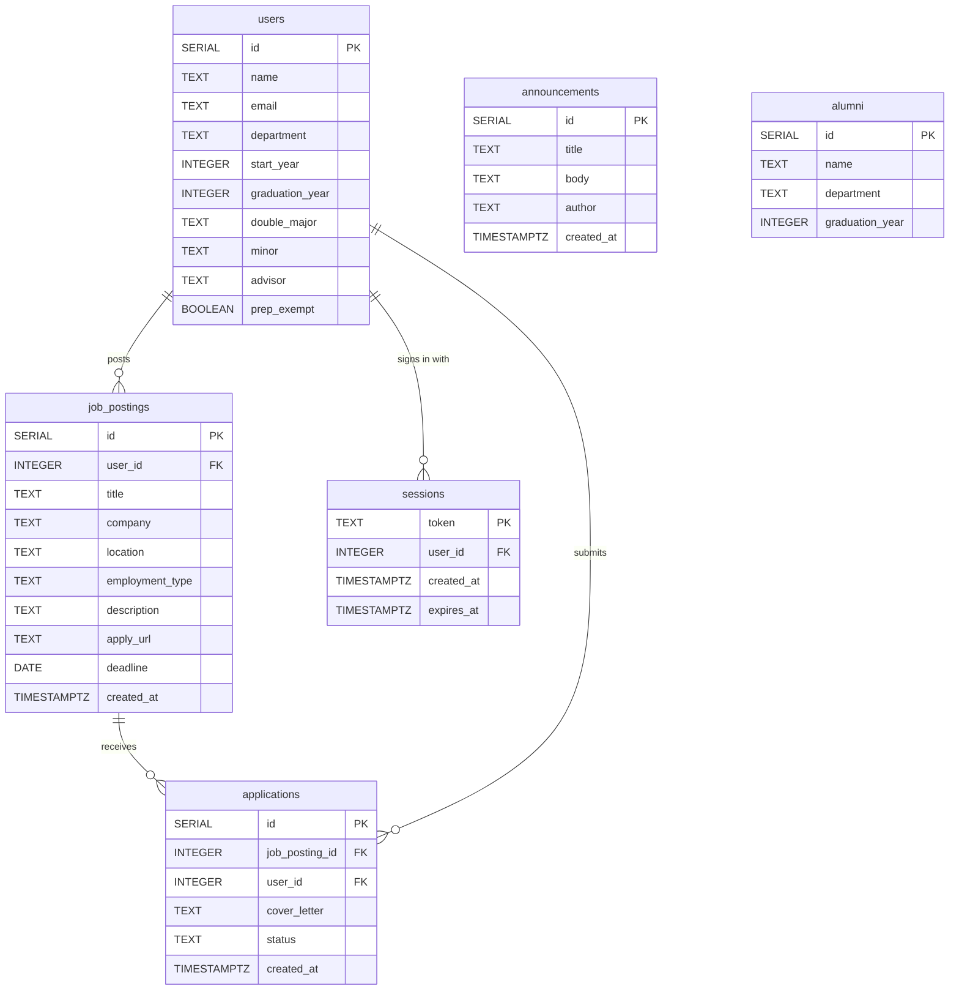

# Data Design Documentation

← Back to the [README](README.md)

This document describes the data the Alumni app stores **today**: where it lives, the tables,
their columns and rules, and how a row travels between PostgreSQL, Go and JSON. The longer-term
schema the platform is heading towards is in the README's [Data Model](README.md#data-model)
section.

## Contents

- [Where the data lives](#where-the-data-lives)
- [Entity–relationship diagram](#entityrelationship-diagram)
- [Tables](#tables)
  - [users](#users)
  - [announcements](#announcements)
  - [alumni](#alumni)
  - [job_postings](#job_postings)
  - [applications](#applications)
  - [sessions](#sessions)
- [Migrations](#migrations)
- [Seed data](#seed-data)
- [Validation rules](#validation-rules)
  - [Planned rules for job postings](#planned-rules-for-job-postings)
- [Users and roles (authorization)](#users-and-roles-authorization)
  - [Roles](#roles)
  - [What each role may do](#what-each-role-may-do)
  - [Ownership rules](#ownership-rules)
  - [How a request is checked](#how-a-request-is-checked)
  - [Data the roles need](#data-the-roles-need)
- [From a request to a row](#from-a-request-to-a-row)
- [Design decisions](#design-decisions)
- [Known limits and next steps](#known-limits-and-next-steps)

## Where the data lives

```
 Postman / browser
        │  HTTP + JSON / HTML forms
        ▼
 ┌──────────────┐   SQL (pgx)    ┌──────────────┐
 │ app (Go)     │ ─────────────▶ │ db (Postgres)│
 │ port 8080    │                │ port 5432    │
 └──────────────┘                └──────┬───────┘
        ▲                               │ files
        │ /run/secrets/db_password      ▼
 secrets/db_password.txt         volume: db-data
```

| Piece | What it is | Defined in |
| --- | --- | --- |
| **Database** | PostgreSQL 17, the only place the app stores data | `docker-compose.yml` → `db` |
| **Volume `db-data`** | Postgres' data files. Survives `docker compose down`; only `down -v` deletes it | `docker-compose.yml` → `volumes` |
| **Schema** | Numbered migrations; the `migrate` service applies the new ones on every `up` | `migrations/`, `docker-compose.yml` → `migrate` |
| **Seed data** | Fixed samples + random records from the factories, added on demand | `internal/seed/`, `cmd/seed/`, `docker-compose.yml` → `seed` |
| **Password** | A Docker Compose secret, read from a file by both containers; never in git or in the image | `secrets/db_password.txt`, `docker-compose.yml` → `secrets` |
| **Connection** | One `pgxpool` connection pool, opened at startup | `internal/model/db.go` |

## Entity–relationship diagram



`job_postings` and `applications` are linked to `users` by foreign keys: every posting belongs
to the user who posted it, and every application belongs to one posting and to the user who
applied. Through `applications`, users and job postings are **many-to-many**: a user can apply
to many postings, and a posting can receive applications from many users. The other tables
are still **independent**: `announcements.author` is free text, not a link to `users`. See
[Known limits](#known-limits-and-next-steps).

## Tables

Every table has an `id SERIAL PRIMARY KEY`: Postgres assigns the next number on `INSERT`, and
the app never takes an id from a request body. Text columns are `TEXT` (Postgres stores any
length the same way, so there is no reason to pick a `VARCHAR(n)` limit).

### users

One account on the network. Model: `internal/model/user.go` · API: `/api/users` · Pages: `/users`

| Column | Type | Null | Default | JSON field | Meaning |
| --- | --- | --- | --- | --- | --- |
| `id` | `SERIAL` | no | next number | `id` | primary key |
| `name` | `TEXT` | no | — | `name` | full name |
| `email` | `TEXT` | no | — | `email` | contact email |
| `department` | `TEXT` | no | — | `department` | bölüm |
| `start_year` | `INTEGER` | no | — | `startYear` | year the user started university |
| `graduation_year` | `INTEGER` | no | — | `graduationYear` | mezuniyet yılı |
| `double_major` | `TEXT` | no | `''` | `doubleMajor` | ÇAP; `''` means none |
| `minor` | `TEXT` | no | `''` | `minor` | yandal; `''` means none |
| `advisor` | `TEXT` | no | `''` | `advisor` | danışman; `''` means none |
| `prep_exempt` | `BOOLEAN` | no | `false` | `prepExempt` | exempt from the English prep year |
| `password_hash` | `TEXT` | no | `''` | — (never sent) | bcrypt hash of the password set on `/register`; `''` for users created any other way |
| `role` | `TEXT` | no | `'member'` | `role` (read-only) | `member` (not verified yet), `graduate` (verified), `admin`; a `CHECK` constraint refuses any other value. Changed only by `POST /users/{id}/role` |

### announcements

One post on the announcement board. Model: `internal/model/announcement.go` · API:
`/api/announcements` · Pages: `/announcements`

| Column | Type | Null | Default | JSON field | Meaning |
| --- | --- | --- | --- | --- | --- |
| `id` | `SERIAL` | no | next number | `id` | primary key |
| `title` | `TEXT` | no | — | `title` | headline |
| `body` | `TEXT` | no | — | `body` | the announcement text |
| `author` | `TEXT` | no | — | `author` | who posted it, e.g. "Kariyer Merkezi" |
| `created_at` | `TIMESTAMPTZ` | no | `now()`, rounded to the second | `createdAt` | set by the database; an update keeps it |

Lists are ordered newest first (`ORDER BY created_at DESC, id DESC`).

### alumni

A graduate in the simple directory. Model: `internal/model/alumni.go` · API: `/alumni` · Pages: `/graduates`

| Column | Type | Null | Default | JSON field | Meaning |
| --- | --- | --- | --- | --- | --- |
| `id` | `SERIAL` | no | next number | `id` | primary key |
| `name` | `TEXT` | no | — | `name` | full name |
| `department` | `TEXT` | no | `''` | `department` | bölüm |
| `graduation_year` | `INTEGER` | no | `0` | `graduationYear` | `0` means not given |

### job_postings

A job or internship opening posted by a graduate, for graduates. Model:
`internal/model/job_posting.go` · API: `/api/job-postings` · Pages: `/job-postings`

| Column | Type | Null | Default | JSON field | Meaning |
| --- | --- | --- | --- | --- | --- |
| `id` | `SERIAL` | no | next number | `id` | primary key |
| `user_id` | `INTEGER` | no | — | `userId` | who posted it; foreign key to `users.id` |
| `title` | `TEXT` | no | — | `title` | position, e.g. "Junior Backend Developer" |
| `company` | `TEXT` | no | — | `company` | the hiring company |
| `location` | `TEXT` | no | `''` | `location` | city, or "Remote"; `''` means not given |
| `employment_type` | `TEXT` | no | — | `employmentType` | `full_time`, `part_time` or `internship` |
| `description` | `TEXT` | no | — | `description` | the posting text |
| `apply_url` | `TEXT` | no | `''` | `applyUrl` | where to apply; `''` means contact the poster |
| `deadline` | `DATE` | **yes** | `NULL` | `deadline` | last day to apply; `null` means open until filled |
| `created_at` | `TIMESTAMPTZ` | no | `now()`, rounded to the second | `createdAt` | set by the database; an update keeps it |

`user_id` is declared `REFERENCES users(id) ON DELETE CASCADE`: Postgres refuses a posting
for a user that does not exist, and deleting a user deletes their postings with them.
`deadline` is the only nullable column in the schema, because "no deadline" is not a date.
Lists are ordered newest first (`ORDER BY created_at DESC, id DESC`).

### applications

A user's application to a job posting. Model: `internal/model/application.go` · API:
`/api/applications`

| Column | Type | Null | Default | JSON field | Meaning |
| --- | --- | --- | --- | --- | --- |
| `id` | `SERIAL` | no | next number | `id` | primary key |
| `job_posting_id` | `INTEGER` | no | — | `jobPostingId` | the posting applied to; foreign key to `job_postings.id` |
| `user_id` | `INTEGER` | no | — | `userId` | who applied; foreign key to `users.id` |
| `cover_letter` | `TEXT` | no | `''` | `coverLetter` | a short note to the poster; `''` means none |
| `status` | `TEXT` | no | `'pending'` | `status` | `pending`, `accepted` or `rejected` |
| `created_at` | `TIMESTAMPTZ` | no | `now()`, rounded to the second | `createdAt` | set by the database; an update keeps it |

Both foreign keys are `ON DELETE CASCADE`: deleting a posting deletes its applications, and
deleting a user deletes the applications they made. The pair `(job_posting_id, user_id)` is
`UNIQUE`, so a user can apply to the same posting only once. Lists are ordered newest first.

### sessions

One signed-in browser. Model: `internal/model/session.go` · Pages: `/login`, `POST /logout`

| Column | Type | Null | Default | Meaning |
| --- | --- | --- | --- | --- |
| `token` | `TEXT` | no | — | primary key; 64 random hex characters, the value of the browser's `session` cookie |
| `user_id` | `INTEGER` | no | — | foreign key → `users.id`, `ON DELETE CASCADE`: deleting a user signs them out everywhere |
| `created_at` | `TIMESTAMPTZ` | no | `now()` | when they signed in |
| `expires_at` | `TIMESTAMPTZ` | no | — | sign-in time + 7 days; an expired row no longer counts as signed in |

Signing in (`POST /login`) checks the password against `users.password_hash` with bcrypt,
inserts a row and sends the token as an `HttpOnly`, `SameSite=Lax` cookie. On every request the
`Session` middleware looks the cookie's token up and, when it is valid, puts the user in the
request's context, so pages can show who is signed in. Signing out (`POST /logout`) deletes the
row and the cookie. The README plans sessions in Redis; until Redis is added they live here.

## Migrations

The tables are not created by hand: each change to the schema is a numbered migration in
`migrations/`, with an `up` file that applies it and a `down` file that undoes it. The README's
[Migrations](README.md#migrations) section has the commands.

| # | Migration | Up | Down |
| --- | --- | --- | --- |
| 1 | `create_users` | creates `users` | drops `users` |
| 2 | `create_announcements` | creates `announcements` | drops `announcements` |
| 3 | `create_alumni` | creates `alumni` | drops `alumni` |
| 4 | `create_job_postings` | creates `job_postings` with its foreign key to `users` | drops `job_postings` |
| 5 | `create_applications` | creates `applications` with its foreign keys to `job_postings` and `users` | drops `applications` |
| 6 | `add_users_password` | adds `users.password_hash` | drops the column |
| 7 | `add_users_role` | adds `users.role`, `'member'` for every existing row | drops the column |
| 8 | `create_sessions` | creates `sessions` with its foreign key to `users` | drops `sessions` |

Postgres keeps a one-row table, `schema_migrations`, with the number of the last migration
applied (`version`) and whether one failed halfway (`dirty`). `migrate up` compares it with the
files and runs only the newer ones, so existing rows are never touched by a restart.

## Seed data

Migrations create empty tables; the **seeder** fills them. The README's
[Factories and seeding](README.md#factories-and-seeding) section has the commands.

| Table | Fixed samples (only into an empty table) | Random records from the factory |
| --- | --- | --- |
| `users` | Ayşe Yılmaz, Mehmet Demir | name from Turkish first/last name lists; email `first.last.N@example.com` (unique); department from a list; start year 4–20 years ago; graduation 4–6 years later, not in the future; optional fields filled only sometimes |
| `announcements` | "Mezunlar buluşması", "Kariyer günleri başvuruları açıldı" | title and author from lists; body names a department |
| `alumni` | Ayşe Yılmaz, Mehmet Demir | name and department from lists; graduation year in the last 30 years |
| `job_postings` | "Junior Backend Developer" at Trendyol (first user), "Hukuk Stajyeri" (second user) | posted by a random existing user; title and company fit that user's department (a Tıp graduate posts "Asistan Hekim" at a hospital); location and type from lists; an apply link and a deadline (1–12 weeks ahead) only sometimes |
| `applications` | — | not seeded yet |
Seeded rows go through the same `Validate()` and store methods as an API request, so the seeder
can never put a row in the database that the API would reject.

## Validation rules

The database only guarantees that a column is present (`NOT NULL`). The content rules live in
the model's `Validate()` methods and are checked **before** any SQL runs; a rule that fails
returns `400 Bad Request` and nothing is written.

| Table | Rule | Where |
| --- | --- | --- |
| `users`, `announcements` | every text field is trimmed of surrounding spaces | `Validate()` |
| `users` | `name`, `email`, `department`, `startYear`, `graduationYear` are required | `User.Validate()` |
| `users` | `startYear` between 1900 and the current year | `User.Validate()` |
| `users` (sign-up) | password at least 8 characters, typed twice the same; terms accepted | `RegisterController.Store` |
| `users` (sign-up) | no second account with the same email, ignoring case → `409 Conflict` | `UserStore.EmailTaken` |
| `users` | `graduationYear` not before `startYear` and not in the future | `User.Validate()` |
| `users` | a PATCH must change at least one field, and the patched user must pass every rule above | `UserPatch.Validate()`, then `User.Validate()` |
| `announcements` | `title`, `body`, `author` are required | `Announcement.Validate()` |
| `alumni` | `name` is required; `name` and `department` are trimmed | `Alumni.Validate()` |
| `job_postings` | every text field is trimmed; `userId`, `title`, `company`, `employmentType`, `description` are required | `JobPosting.Validate()` |
| `job_postings` | `employmentType` is one of `full_time`, `part_time`, `internship` | `JobPosting.Validate()` |
| `job_postings` | `deadline`, when given, is not in the past | `JobPosting.Validate()` |
| `job_postings` | `userId` must be an existing user — checked by the database (foreign key), answered with `400` | Postgres |
| `applications` | `jobPostingId` and `userId` are required; `coverLetter` is trimmed; an empty `status` becomes `pending` | `Application.Validate()` |
| `applications` | `status` is one of `pending`, `accepted`, `rejected` | `Application.Validate()` |
| `applications` | `jobPostingId` and `userId` must exist — checked by the database (foreign keys), answered with `400` | Postgres |
| `applications` | one application per user per posting — checked by the database (`UNIQUE`), answered with `409 Conflict` | Postgres |

### Planned rules for job postings

These rules are agreed but **not written in code yet**: the API still accepts a posting that
breaks them. When a rule is implemented, move it into the table above and delete it here.
Lengths count characters, not bytes, so a Turkish letter like `ş` counts as one.

| Field / action | Rule | Status |
| --- | --- | --- |
| `title` | 3 to 120 characters | not in code yet |
| `company` | at most 100 characters | not in code yet |
| `location` | required (a city, or "Remote"); at most 100 characters. Today it is optional and `''` means not given | not in code yet |
| `description` | 30 to 5000 characters | not in code yet |
| `applyUrl` | optional; when given, starts with `http://` or `https://` | not in code yet |
| `deadline` | at most one year from today | not in code yet |
| new posting | the same user cannot have two open postings with the same `company` and `title` | not in code yet |
| applying | no application after the posting's `deadline` | not in code yet |
| applying | a user cannot apply to their own posting | not in code yet |
| edit / delete | only the user who posted it may change or delete a posting (needs sign-in first) | not in code yet |

## Users and roles (authorization)

This section is the **planned** design: **none of it is in code yet**. Today every route is
open to anyone who can reach the app. Like the planned job-posting rules above, update this
section when a rule is implemented.

Two words that are easy to mix up:

- **Authentication** answers *who are you?* The user signs in with email and password and gets
  a session (Redis, see the README's [Tech Stack](README.md#tech-stack)).
- **Authorization** answers *what may you do?* The app looks at the signed-in user's **role**,
  and sometimes at whether they **own** the row, before it runs the action.

### Roles

Every account has exactly one role, stored in `users.role`. A visitor who is not signed in has
no account row, so "guest" is not stored anywhere: it is simply "no session".

| Role | Who | How they get it |
| --- | --- | --- |
| `guest` | anyone not signed in | — (no account) |
| `member` | signed up, graduation **not verified yet** | default role at sign-up |
| `graduate` | a verified Istanbul University graduate | an admin approves their verification request |
| `admin` | runs the platform: verification, moderation, institutional announcements | set by another admin; the first admin is created by the seeder |

The roles are ordered: `guest` < `member` < `graduate` < `admin`. A higher role can do everything
a lower one can, unless a row below says otherwise. That is why the platform stays closed:
the directory and the job board need `graduate` (README: *everyone in the feed is a verified
Istanbul University graduate*).

### What each role may do

✅ allowed · ❌ refused · **own** = only their own rows (see [Ownership rules](#ownership-rules))

| Resource | Action | guest | member | graduate | admin |
| --- | --- | --- | --- | --- | --- |
| pages | home, about, 404 | ✅ | ✅ | ✅ | ✅ |
| account | sign up, sign in | ✅ | — | — | — |
| account | sign out | — | ✅ | ✅ | ✅ |
| `users` | list, view profiles | ❌ | own | ✅ | ✅ |
| `users` | edit, delete | ❌ | own | own | ✅ |
| `users` | change `role` | ❌ | ❌ | ❌ | ✅ |
| `alumni` (`/graduates`) | list, view | ❌ | ❌ | ✅ | ✅ |
| `alumni` | create, edit, delete | ❌ | ❌ | ❌ | ✅ |
| `announcements` | list, view | ✅ | ✅ | ✅ | ✅ |
| `announcements` | create, edit, delete | ❌ | ❌ | ❌ | ✅ |
| `job_postings` | list, view | ❌ | ❌ | ✅ | ✅ |
| `job_postings` | create | ❌ | ❌ | ✅ | ✅ |
| `job_postings` | edit | ❌ | ❌ | own | ❌ |
| `job_postings` | delete | ❌ | ❌ | own | ✅ |
| `applications` | apply | ❌ | ❌ | ✅ | ❌ |
| `applications` | list, view | ❌ | ❌ | own + to own postings | ✅ |
| `applications` | change `status` | ❌ | ❌ | to own postings | ❌ |
| `applications` | withdraw (delete) | ❌ | ❌ | own | ✅ |
| verification requests | review, approve, reject | ❌ | ❌ | ❌ | ✅ |

Why some rows are shaped the way they are:

- **Announcements are readable by guests.** They are the public face of the network
  ("Kariyer günleri başvuruları açıldı"), and they hold no personal data.
- **Admins cannot edit someone else's posting or decide an application.** They can delete for
  moderation, but the content and the hiring decision belong to the poster.
- **Admins do not apply to postings.** An admin account is for running the platform; an admin
  who is also a graduate uses a separate `graduate` account.

### Ownership rules

"own" in the table above means:

| Resource | The user owns a row when |
| --- | --- |
| `users` | `users.id` = the signed-in user's id |
| `job_postings` | `job_postings.user_id` = the signed-in user's id |
| `applications` (as applicant) | `applications.user_id` = the signed-in user's id |
| `applications` (as poster) | the application's posting has `job_postings.user_id` = the signed-in user's id |

Because the owner comes from the session, **the client never sends `userId`** when it creates a
posting or an application: the app fills it in. Today the API still takes `userId` from the
body; that field goes away with sign-in.

### How a request is checked

```
 request ─▶ Logger ─▶ guardians ─▶ Auth (read session) ─▶ role check ─▶ ownership check ─▶ handler
                                       │                     │                 │
                                       ▼                     ▼                 ▼
                                 401 not signed in     403 role too low    403 not yours
```

| Answer | When | Example reason |
| --- | --- | --- |
| `401 Unauthorized` | the route needs sign-in and there is no valid session | `sign in first` |
| `403 Forbidden` | signed in, but the role is too low | `only verified graduates can see job postings` |
| `403 Forbidden` | right role, but the row belongs to someone else | `you can only edit your own posting` |

The answers use the same JSON shape as the guardians (`{status, error, reason, path}`). A
browser (`Accept: text/html`) that gets a `401` is redirected to the sign-in page instead, the
same way a `404` is redirected to `/404` today.

The role check happens **on the server, on every request**. Hiding a button in the page is only
for convenience: a user can still send the request from Postman.

### Data the roles need

Planned columns on `users` (a new migration):

| Column | Type | Null | Default | Meaning |
| --- | --- | --- | --- | --- |
| `password_hash` | `TEXT` | no | — | bcrypt hash; the password itself is never stored |
| `role` | `TEXT` | no | `'member'` | one of `member`, `graduate`, `admin` (`CHECK` constraint) |
| `email` | — | — | — | becomes `UNIQUE`: it is the sign-in name |

Planned table `verifications`, one row per request (an audit trail, as in the README's
[Data Model](README.md#data-model)):

| Column | Type | Meaning |
| --- | --- | --- |
| `id` | `SERIAL` | primary key |
| `user_id` | `INTEGER` → `users.id` | who asks to be verified |
| `proof` | `TEXT` | e.g. the e-Devlet graduation document's verification code |
| `status` | `TEXT` | `pending`, `approved`, `rejected` |
| `reviewer_id` | `INTEGER` → `users.id`, nullable | the admin who decided |
| `created_at`, `decided_at` | `TIMESTAMPTZ` | when it was sent and decided |

Approving a request sets `verifications.status = 'approved'` and `users.role = 'graduate'` in
one transaction, so the two can never disagree.

## From a request to a row

The names change on the way through, one convention per layer:

| Layer | Naming | Example |
| --- | --- | --- |
| JSON / HTML form | camelCase | `graduationYear` |
| Go struct field | PascalCase, mapped by the `json:"…"` tag | `GraduationYear` |
| SQL column | snake_case | `graduation_year` |

Creating a user, step by step:

1. `POST /api/users` with a JSON body reaches `ApiUserController.Store`.
2. `decodeJSON` reads the body into a `model.User`; unknown fields are rejected.
3. `User.Validate()` trims and checks it → `400` if a rule fails.
4. `model.Users.Add` runs `INSERT … RETURNING …`; Postgres assigns `id`.
5. The returned row is sent back as JSON with `201 Created`.

If the database itself fails (it is down, a query is wrong) the controller answers `500` with
the reason `database error` (as JSON, written by `ServerErrorGuardian`) and does not show the
internal error to the client; `dbError` writes the real error to the terminal and to
`logs/error.log`. A missing row is a `404` with a reason such as `no user with that id`.

## Design decisions

| Decision | Why |
| --- | --- |
| **PostgreSQL in its own container** | The app container can be rebuilt and replaced at any time; the data must not depend on it. |
| **Named volume `db-data`** | A container's own files are deleted with the container. A named volume outlives `docker compose down`, so records survive it (the "forgetting test"). |
| **Password as a Compose secret** | An environment variable shows up in `docker inspect` and can leak into logs. A secret is a file mounted only inside the containers that need it, and `secrets/` is in `.gitignore` and `.dockerignore`. |
| **Schema as migrations (golang-migrate)** | The schema can change while the data stays: a new migration is applied on top of the existing tables, and a `down` file can undo it. The tool runs in its own container, so the Go app has no migration code. |
| **Database assigns ids and `created_at`** | Two requests at the same moment can never get the same id, and a client cannot fake a creation time. |
| **Store methods return `(value, found, error)`** | "No row with that id" (`404`) and "the database failed" (`500`) are different answers, so they are different return values. |
| **Plain SQL with `pgx`, no ORM** | Each query is visible in the model file, and there is one small dependency. |

## Known limits and next steps

- **Few relations.** Only `job_postings` and `applications` have foreign keys so far;
  `announcements.author` should become one too.
- **`users` and `alumni` overlap.** Both hold a name, department and graduation year. The
  README's [Data Model](README.md#data-model) plans one `users` table for accounts and an
  `alumni_profiles` table linked one-to-one.
- **`email` is not unique.** Two users can share an address until sign-in needs it to be
  unique (`UNIQUE` constraint).
- **No indexes beyond the primary keys.** Fine at this size; search will need them.

← Back to the [README](README.md)
